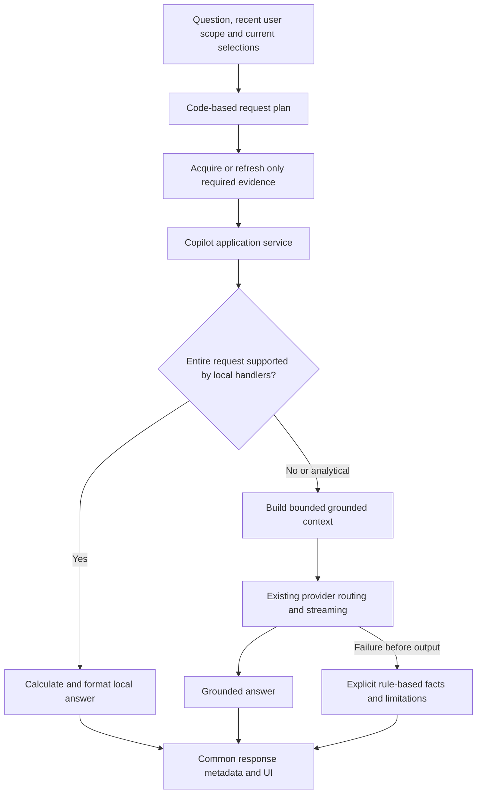

# OpenEmber local-query routing and grounded-context implementation plan

Date: November 11, 2026

Status: phase 5 validation is complete; native grounding and synthesis usability gates failed, so hybrid remains experimental behind the default-legacy execution switch. Native retention, regression, construction parity and packaged browser delivery checks pass; live cloud answer acceptance remains pending authorization. See [phase 5 acceptance and performance results](copilot-phase-5-acceptance.md), [phase 1 inventory and baseline](copilot-phase-1-contracts-and-baseline.md), [phase 2 implementation and verification](copilot-phase-2-local-queries.md), [phase 3 bounded synthesis](copilot-phase-3-bounded-synthesis.md), and [phase 4 fallback and parity](copilot-phase-4-fallback-and-parity.md).

November 13 follow-up: shared local grounding and concise-response guidance, retained failure fixtures and a repeated native comparison are documented in [grounding and conciseness results](copilot-grounding-and-conciseness-2026-11-13.md). Native grounding remains a failed promotion gate; hybrid stays experimental.

November 14 follow-up: the [shared date/window contract](copilot-date-window-contract.md) now drives timestamp-based forecast and independent grid selection in both runtimes, with shared regression cases and aligned base grounding rules. Native model acceptance remains open.

Reference: AIDA's current `CopilotService`, `CopilotContextBuilder`, response contract, and provider-bypass tests

## 1. Problem and intended behavior

OpenEmber currently builds a broad system context and sends ordinary questions to Ollama. The latest fixed workload supplied about 12,300 input tokens; thinking-off requests took 299–334 seconds, with 235–263 seconds spent processing the input. A smaller context allocation reduced model memory but did not establish an overall speed improvement. See [measurements and limitations](local-performance-tuning-2026-11-11.md).

Adopt AIDA's approach: application services answer supported questions directly from available data; other questions receive bounded, grounded model synthesis. Users retain free-form questions. Routing runs in code before provider discovery or inference and adds no classification-model request.

**Compatibility requirement:** preserve the current cloud Copilot's complete supported inquiry surface, including unrestricted questions, explanations, summaries and cross-source synthesis over the enabled KB and supplied evidence. Weather, 311 and feature counts are the initial fast-path operations and performance fixtures, not a whitelist of questions the product will answer. An unrecognized local intent goes to the existing LLM-capable path; it is not an unsupported question merely because no local handler matches.

### Existing functionality that must survive

| Current capability | Preservation requirement |
| --- | --- |
| General questions about enabled KB modules | Continue automatic LLM access to all enabled modules: flood zones, evacuation zones, critical infrastructure, hazard profiles, contacts/resources, and configured extensions. The user need not say “use the KB.” |
| KB explanations, comparisons, summaries and drafting | Preserve free-form model synthesis, including multi-module and whole-KB inquiries; routing is not limited to named intents or facts. |
| Configured jurisdiction and KB selection | Preserve jurisdiction-specific content, sources, selected modules and current geographic rules. Disabled modules are not silently reintroduced through history. |
| Uploaded documents | Preserve current document Q&A and document-plus-KB synthesis, including existing supported excerpts; full-upload retrieval is an enhancement, not a justification to remove existing coverage. |
| Live/API/NOAA/tidal evidence | Preserve supported source types and current availability/freshness semantics, not only the feeds chosen for benchmarks. |
| Selected map features, loaded layers and catalog metadata | Preserve feature questions and analysis as well as counts, with existing provenance, visibility and catalog-versus-record distinctions. |
| Follow-ups and mixed-source analysis | Preserve current recent-history behavior and scope; comparisons may combine KB, documents, features and live data. |
| Existing cloud provider path | Keep existing server-owned model, provider modes, credentials, grounded prompt rules, streaming, cancellation and partial-response behavior. Do not change hosted configuration. |

Inventory the actual current request builders and UI entry points before coding, and capture any additional capabilities found there in the baseline fixtures. Preserve the behavior of each interface; close existing differences explicitly rather than accidentally treating one interface's smaller evidence set as the common denominator.

**Context policies are provider-specific.** In the initial implementation, cloud synthesis retains the existing evidence acquisition/refresh behavior and full available-context construction, including every enabled KB module, subject to existing provider/input limits. The 3K–5K tuning target applies to the local model experiment only. Do not apply that target or new selective retrieval to cloud by default. Cloud context optimization requires a separately reviewed change and evidence of feature parity.

For the first local optimization, also retain all enabled KB modules in full and reduce unrelated bulky live feeds first. If those KB modules alone exceed a safe local limit, disclose the limitation and preserve the cloud/legacy route under the user's configured provider policy; do not silently discard modules or automatically spend cloud credits. More selective KB retrieval can be a later enhancement after broad KB regression coverage is established.

Expected examples:

| Inquiry | Intended behavior |
| --- | --- |
| Explain the flood zones described in the KB for Long Beach. | LLM synthesis from enabled KB content, with its supplied source attribution. |
| Compare evacuation considerations for Fire Island and the Rockaways. | LLM synthesis across relevant enabled KB modules and jurisdictions. |
| Summarize all enabled KB information for a briefing. | Broad LLM synthesis with all enabled KB modules available; no weather-only routing. |
| Using my uploaded plan and the KB, draft preparedness considerations. | LLM document-plus-KB synthesis with explicit source limits. |
| What is tonight's low and wind in the configured forecast area? | Local forecast handler; exact period, units, interval, URL and fetch time. |
| How many reports are shown in this loaded layer? | Local complete-count handler with current layer/filter/scope evidence. |
| Break down the available 311 electrical-hazard reports. | Local handler using complete aggregate results, including zero categories and complaint limitations. |
| How could tonight's weather affect these facilities? | Grounded synthesis with relevant weather, facility/map evidence and KB passages. |
| What about tomorrow? | Resolve the prior user-request scope when unambiguous; otherwise ask a clarification. |
| Explain tomorrow's weather and compare it with my uploaded evacuation plan. | Grounded synthesis covering both parts; no early return that answers only the weather. |
| Give me an overall situation assessment. | Broader bounded synthesis with explicit coverage and omissions. |

Success is measured separately for local queries and synthesis. A local query must not load a model or depend on provider availability. Synthesis must materially reduce unnecessary input while preserving relevant evidence and grounding quality.

## 2. Keep the design close to AIDA

AIDA reference paths are relative to `/Users/anthonyvota/Projects/ai-dispatch-advisor`:

| AIDA implementation | OpenEmber adaptation |
| --- | --- |
| `backend/app/services/copilot_service.py`: `_respond` dispatches supported intents before `_grounded_or_fallback` | A Copilot application service with ordered, explicit intent predicates, local handlers, then bounded synthesis/fallback. |
| Local services calculate facts and recommendation explanations | Forecast/map/311 services calculate or format facts from structured evidence. No generative extraction is disguised as a local query. |
| `backend/app/services/copilot_context_service.py`: prioritizes selected records and enforces a record budget | Context builder prioritizes selected scope, relevant periods and passages; adds size/token protection because weather grids and documents have uneven record sizes. |
| `backend/app/api_models.py`: `local_query`, `llm_grounded`, `rule_based_fallback`, evidence and response scope | Preserve these execution-mode names and separate provider/model identity from execution mode. |
| `backend/tests/test_copilot_local_queries.py`: recording provider proves zero requests for local queries | Recording provider and discovery spies prove zero model calls, probes, or accidental cloud fallback for supported local queries. |
| `frontend/src/App.tsx`: response-mode, evidence/scope and fallback presentation | Equivalent per-answer labels in both OpenEmber interfaces. |

AIDA's current routing is coded phrase/intent matching, not a general autonomous planner. Its synthesis context is selected and bounded but is not a general document-retrieval engine. Adapt that simple foundation, adding only the weather, map, document and conversational scope handling OpenEmber requires.

Do not copy AIDA's incident/crew rules, synthetic-data labels, operational recommendation policy, provider configuration or domain-specific prompt verbatim. AIDA remains a read-only reference repository.

## 3. Architecture and ownership

An ambiguous request may return a local clarification before acquiring evidence. After partial model output, keep the existing partial-answer/error behavior; do not replay the turn into another answer or replace it with a fallback narrative.

AIDA has one Python backend. OpenEmber already has Node and Python runtimes. Keep those deployment boundaries: implement equivalent small services with one documented contract and common JSON conformance fixtures. Do not introduce a separate always-running Python service solely to share code, and do not route Python through a subprocess or browser through another inference engine.

Proposed modules, with final names settled in phase 1:

| Responsibility | JavaScript | Python |
| --- | --- | --- |
| Pure intent/scope planning | `lib/copilot-intent.js` | `streamlit/copilot_intent.py` |
| Local query handlers | `lib/copilot-local-queries.js` | `streamlit/copilot_local_queries.py` |
| Bounded context construction | `lib/copilot-context.js` | `streamlit/copilot_context.py` |
| Application orchestration/fallback | `lib/copilot-service.js` | `streamlit/copilot_service.py` |
| Shared contract/examples | `shared/copilot/` JSON schemas, routing policy data where useful, and fixtures | Same resources |

Keep provider modules (`lib/ollama.js`, `streamlit/ollama_provider.py`) focused on transport/routing. The application service calls them only for synthesis. Preserve one provider-routing implementation; where different providers require different context policies, add a narrowly scoped server-owned message-construction callback to the existing attempt loop rather than duplicating its fallback logic in another service. Keep the session-owned Streamlit worker, cancellation behavior and automatic renderer intact, injecting the application-service stream rather than bypassing the worker.

React currently submits serialized messages to `/api/chat`; Streamlit builds messages directly. Add a versioned structured request for the new path with question, bounded history, jurisdiction, selected location/layer/feature references, and typed evidence snapshots. Preserve the messages-only path temporarily for existing consumers and benchmarks, labeled as legacy; exercise the new path in its own end-to-end benchmarks. Do not claim a legacy replay validates the new coordinator. Expose the supported request-contract version and legacy/hybrid capability independently of model availability. New clients negotiate support; older clients continue using messages-only requests. Capability negotiation must not require a successful model probe before a local answer can run.

React may use the same pure intent module before fetching evidence, but the server must recompute and validate the plan. A browser route hint is not authority. Keep a full request-scoped evidence snapshot available independently of the compact local prompt. A pre-stream local-to-cloud fallback must rebuild the normal cloud context from that snapshot; it must not reuse the local reduced prompt and thereby lose cloud functionality. Existing messages-only consumers retain static-message behavior. Test the per-provider message construction without changing the existing post-first-frame commitment rule. Browser-supplied snapshots represent the user's loaded data, not independently server-verified observations; preserve their provenance and state, validate their schema, and never expose keys or permit request-controlled provider settings or arbitrary server fetch URLs.

Update Docker packaging to include any new shared runtime resources. Both containers must work without repository bind mounts. No hosted deployment or configuration changes are part of implementation acceptance.

## 4. Request planning and evidence contract

The request plan records intent(s), local/synthesis/clarification outcome, resolved geography, time interval/timezone, selected sources and requested fields. Use explicit supported patterns and semantic guards rather than treating the presence of one keyword as sufficient. Do not present an uncalibrated confidence score as proof of a match.

Rules:

- Resolve explicit place, source and time before defaults. Default only to documented current selections or configured coverage; never silently substitute a different geography.
- Selected features/layers disambiguate references such as “this layer.” Multiple matching layers require clarification unless the question explicitly requests each one.
- Use recent user requests and explicit selection state for follow-ups. Earlier assistant prose is not authoritative source data. New scope overrides prior scope; hiding/removing a layer invalidates its current evidence.
- A request with multiple parts uses the direct path only when every part is supported. Otherwise pass all subquestions, any exact local results, and their supporting evidence into one synthesis request.
- Distinguish requested explanation/impact/comparison from a factual lookup. A local handler must not silently answer a related, narrower question.
- Unsupported exact calculations return a precise local limitation only for a recognized operation whose required population/fields are genuinely unavailable or incomplete. A missing local handler alone is not grounds for rejecting the question. KB/document facts that can be answered from supplied text remain eligible for model synthesis; do not have the model extrapolate exact totals from examples.
- Add an explicit “Use AI analysis” request preference (`auto` versus `model`) so users can obtain a model response even when a direct handler exists. It changes answer method, never provider permissions, model selection or source visibility. In `model` mode, include applicable deterministic results as grounded evidence rather than replacing the requested explanation with a template.
- A failed lexical match must not remove enabled KB access or trigger a canned generic fallback. Broad, unfamiliar and conceptual requests retain the model-capable route, using the full enabled KB and the applicable provider context policy.

Each evidence block carries an ID, kind, source name/URL, fetched time, valid interval where applicable, geography/filter/scope, availability/freshness/completeness state, structured values, and relevant limitations. Document blocks include filename and stable passage references; catalog descriptions remain catalog metadata, not loaded feature inventories.

Use states that distinguish unavailable, stale, hidden, partial and omitted-by-selection/budget. Unknown is not zero. Preserve original source timestamps/UTC offsets and units. For broad questions, disclose which relevant evidence is included and which could not fit. Do not send the entire source catalog or every full record merely to report coverage.

For direct queries and compact local synthesis, evidence acquisition follows the plan: a document or map query must not wait for unrelated weather refreshes or the entire initial NOAA fetch batch. Refresh required missing/stale sources within existing source-specific deadlines. Cloud synthesis initially preserves the legacy acquisition/refresh behavior and source coverage; if a local attempt falls back to cloud, complete the cloud-required evidence acquisition before constructing its full prompt while preserving the original question, selections and visibility scope. Cached local answers and answers requiring network fetches have separate timings.

## 5. Initial direct-answer scope

Implement only the following supported operations initially, covering common wording and negative/ambiguous cases with fixtures:

1. **Point-forecast facts:** a named available period, the first period, or an explicit interval covered by the supplied forecast. Return requested temperatures/high-vs-low, full wind range/direction, conditions and precipitation probability when available, original valid times, exact URL and fetch time. Handle day versus night and DST explicitly. Do not answer rainfall amounts from probability, or blend separate forecast products without identifying them.
2. **Loaded-map totals:** one or more explicitly identified visible layers with a complete query result. Use `complete_count`, not sample size, displayed markers or distinct-organization assumptions. Preserve geography, filter, query scope, source URL and fetch time. A hidden, removed, failed, partial or ambiguous layer produces a clear gap/clarification, never a stale exact count. Avoid adding overlapping layers into an unsupported deduplicated total.
3. **NYC 311 reported-hazard counts:** return validated total/category aggregates, including zero categories, exact reporting window/timezone, configured endpoint, filter and fetch time. Distinguish reported complaints from utility-confirmed outages. Partial aggregates cannot establish exact category totals.

Use deterministic answer templates and citations, not a model that paraphrases the “local” result. General KB Q&A, KB explanations and summaries, uploaded-document Q&A, operational risk assessments, inferred impacts and cross-source comparisons remain grounded synthesis in the initial scope. These capabilities are mandatory compatibility scope, not deferred features.

## 6. Bounded synthesis and system prompt

Follow AIDA's selected-record-first service separation, with the cloud compatibility policy above and a distinct local performance policy. For local synthesis:

- Keep the complete question and core grounding rules.
- Include selected features/layers and exact local results needed by the question, retaining metadata and limitations.
- Select forecast periods by requested place/time; omit unrelated hourly/grid products when they do not support the question. Preserve the full relevant period and required interval boundaries.
- Retain all enabled KB modules in full initially. Use lexical matching, aliases and headings for document retrieval and optional source prioritization, with neighboring text preserved. Search the full supported upload, not only the current first-4000-character excerpt; disclose upload-size limits and extraction gaps. Do not gate basic KB access on retrieval success. New KB/module types must not require a new hardcoded query handler to remain usable.
- Reserve space for all parts of compound questions and relevant recent history. Do not let a large early source consume the entire budget.
- Use record caps plus per-source size caps, total input accounting and generation headroom. A record count alone does not bound a long grid or document.
- Begin performance experiments around 3K–5K actual input tokens; treat that as a tuning target, not a requirement to remove necessary evidence. If mandatory evidence will not fit, narrow scope through clarification or a clearly bounded response rather than silently cutting it off.
- Select a model-compatible token-accounting method in phase 1. Where exact accounting is unavailable, label estimates, use conservative headroom, and require native input-retention verification; a character count must not be reported as a token count. Fail acceptance on native input truncation.

Do not add embeddings, a vector database, an LLM classifier, automatic multi-step tool loops, or a new model download to the first implementation. A future retrieval refinement must demonstrate a gap in the simpler implementation.

Keep a small versioned system prompt with the existing forecast/citation rules plus these instructions: use supplied evidence only; respect coverage and selection states; separate facts from inferred impacts; copy URLs and units exactly; do not extrapolate totals from bounded samples; identify missing evidence and unresolved parts. The code, not the prompt, chooses the direct path and enforces calculations and budgets.

If evidence is genuinely missing, the first implementation asks a focused clarification or states the gap. A local budget or selector failure is a processing limitation, not proof that the source is unavailable. Preserve the broader cloud/legacy model path under existing permissions for content that the current cloud implementation supports. An automatic retrieval-expansion loop is deferred. No model should invent an unavailable source or silently reuse an earlier hidden-layer count.

## 7. Response metadata and UI

Preserve AIDA's execution modes:

| Execution mode | Suggested UI label | Provider/model fields |
| --- | --- | --- |
| `local_query` | Local data query | Null; includes clarification/unsupported local results with an explicit answer status. |
| `llm_grounded` | Grounded AI · Local/Cloud · model | Actual committed provider/model, separate from execution mode. |
| `rule_based_fallback` | Rule-based fallback | Attempt metadata if applicable; no invented successful provider identity. |

The common result includes contract version, intent(s), answer status, answer, evidence references, response scope, generated/request time, source-specific freshness, warnings and timing. Fallback contains available deterministic facts plus an explicit explanation of what analysis could not be produced; it must not masquerade as an equivalent AI assessment. Preserve existing local-only/local-first/cloud-only routing rules and pre-stream fallback boundaries. User cancellation is not a trigger for fallback.

Extend the existing NDJSON transport with response metadata while retaining content and terminal `done` frames, so both direct and model answers follow one delivery path. Add an `onResponse`-style callback independently of existing provider metadata. A direct answer emits no fake Ollama provider frame or thinking/load metrics. Global provider status remains separate from per-answer execution mode; a successful local answer must not mark an unavailable model available.

Preserve React Stop/Send and partial responses, Streamlit rerun-safe single-worker behavior, enabled controls after completion, and the corrected first `UI sync` metric. Local queries remain usable with Ollama stopped and no cloud key. Local UI status must not misleadingly describe all Copilot functions as unavailable when only inference is unavailable.

## 8. Implementation phases and review points

Each phase is independently reviewable. Implementation begins only in a subsequent authorized coding step; this document does not enable a profile or change app behavior.

| Phase | Deliverables | Required exit evidence |
| --- | --- | --- |
| 0 — Plan | This document, AIDA comparison, initial scope and baseline references. | Reviewable plan; no runtime modifications. |
| 1 — Contracts and fixtures | Current capability inventory and cloud/KB preservation baseline; request/result/evidence contracts; ordered intent policy; source adapters; common JSON fixture corpus; budget-accounting choice; legacy/hybrid switch design. | Both languages produce the same plans and scope decisions, including negative/compound cases. |
| 2 — AIDA-style local path | Initial forecast, map and 311 handlers; application service; response metadata; React/Streamlit integration. | Exact results/citations, zero provider/probe calls, operation with inference unavailable, one normal completion path. |
| 3 — Bounded synthesis | Provider-specific context builders; unchanged full cloud-context adapter; complete enabled KB for local synthesis; question-aware live-source acquisition and document retrieval; model-answer preference. | General KB/cloud inquiry coverage preserved; local reduction cannot leak into cloud fallback; all subquestions covered; local input budgets and gaps verified. |
| 4 — Fallback and parity | Rule-based fallback, error/cancel behavior, response labels, packaged shared resources, compatibility tests. | No partial-output replay, no cloud escape from local-only, identical semantic behavior in both interfaces and packaged runtimes. |
| 5 — Acceptance | Full regression gate; complete KB/cloud compatibility matrix; deterministic and native performance matrix; React and Streamlit browser checks; results report. | Feature parity gates pass before promotion; measured local input/latency reduction reported; live cloud acceptance remains explicit if not authorized. |

Use a server-controlled `legacy`/`hybrid` switch, with equivalent Python configuration. Keep hosted behavior on the existing path until a separately authorized release. Roll back locally by restoring `legacy` and recreating the affected service; keep committed shared files available so rollback does not break startup. Preserve existing environment files and data. No commit, push, merge, deployment, paid cloud inference or model download is implied by this plan.

After each implementation phase, provide the review diff, validation results and a suggested commit message; the user owns review and commit. Check weekly usage at phase boundaries and periodically during benchmarks. Pause new work at **10% weekly remaining**, leaving a clear checkpoint and stopping further benchmark submissions safely.

## 9. Acceptance and performance gates

### Full KB and cloud compatibility gate

Capture a golden legacy evidence/prompt baseline in both interfaces before refactoring. Compare source coverage, grounding rules and answer requirements rather than requiring identical generative prose. Cover:

- Each enabled KB module independently, using non-weather questions: flood-zone explanation, evacuation-route comparison, infrastructure questions, hazard-profile interpretation, and contacts/resources with geographic qualifications.
- Whole-KB summaries, implicit KB use without the word “KB,” conceptual paraphrases without routing keywords, and configured/custom KB content added after implementation.
- Cross-module KB reasoning, uploaded document + KB comparisons, KB + live evidence, selected-feature + KB questions, and follow-ups changing time or place. No local match may swallow part of the requested analysis.
- Enabled/disabled module changes, jurisdiction configuration, supported live/API/tidal source types beyond weather/311, source attribution and supplied URLs where available, source conflicts, stale data and genuine missing facts.
- `auto` versus explicit `model` answers, unrecognized local intents, and broad analytical questions. A question accepted by the current model path must not become a generic “unsupported query” solely due to routing.
- Cloud-only structured requests must receive the same evidence coverage and grounding rules as legacy full-context requests. Compare normalized full context and required evidence blocks with provider spies, including long/late KB facts and a cloud request larger than the local target budget.
- Local-first pre-stream fallback must build full cloud context from the retained evidence snapshot, while local-only remains unable to call cloud and post-first-frame errors retain partial output. Provider-specific prompt selection must not reset or duplicate an inference attempt.

All cloud tests can first use recording/mock providers without credentials or spending. These establish request construction, routing and evidence parity; they do not prove real model answer parity. Any live cloud comparison requires explicit authorization and a separate capability-based acceptance report against the current cloud model. If not run, label that gate pending and keep the hosted refactor unpromoted; passing local weather/311/count fixtures does not close it. Never narrow functionality to make a small benchmark pass.

### Deterministic and parity checks

- Run shared fixtures through the JavaScript and Python planners, handlers and context builders. Compare values, scope, source identities and execution modes, allowing presentation-only differences.
- Record provider generation **and discovery** calls. Supported local queries, clarifications and unsupported-population results must make zero calls, even when the provider is configured and available. A synthesis case makes one generation request per permitted provider attempt, with the expected provider-specific context and prompt version. A local-first pre-stream failure may proceed to one cloud attempt under the configured provider policy; no attempt may be duplicated.
- Exercise route precedence, paraphrases, negation, quoted instructions in documents, selected-feature references, multi-part requests and follow-ups. Arbitrary uploaded text is data and cannot choose the provider or change routing policy.
- Verify day/night forecasts, full wind ranges, original UTC offsets, first versus later period, explicit geography and outside-coverage times. Distinguish hourly temperature from daily highs/lows.
- Verify zero versus unavailable, partial versus complete counts, multiple layers, changed filters, removed/hidden layers, and feature-versus-department distinctions.
- Preserve exact 311 endpoint, all category counts including zero, report interval/timezone, fetch time and complaint-versus-outage limits.
- Preserve synthetic document ID/cone count/absent commander; add a relevant fact beyond character 4000 and a cross-source analytical question so selection cannot pass by copying only the initial excerpt.
- Verify evidence required by a question near the end of a large source survives, or produces an explicit gap; no silent omission presented as source absence.

### Delivery and runtime checks

- Retain the complete `local-first:gate`; add the new conformance, router and context tests to the gate rather than relying on an unrelated legacy benchmark.
- Test the real HTTP adapter and response metadata in React; use production Streamlit renderer/worker tests with a forced full-app rerun, one request, automatic completion and enabled input.
- Check cancellation, pre-stream provider failures, partial output failures, explicit fallback labels and stable first-handoff timing. Local query completion must not depend on a model-status refresh.
- Build both local Docker images and verify packaged resources, configured mode/context and empty cloud key for acceptance. Separately observe both browser interfaces; native HTTP completion or headless AppTest alone does not establish browser delivery.

### Measurement matrix and working targets

Use retained, public/synthetic fixtures and identical questions for legacy versus hybrid comparison. Keep private upload captures outside Git. Separate source acquisition, planning, local execution, model input tokens, prompt processing, first answer, generation and final delivery. Record hashes, provider/configuration, actual allocated context, native truncation/cache indicators and environment. Repeated requests must be sequential, with at least three cold samples of each selected synthesis workload and a cached-data sample set for local queries; never run concurrent inference to shorten the benchmark schedule.

| Workload | Main acceptance |
| --- | --- |
| Cached forecast, visible map and 311 local queries | Zero inference; working target under one second from Send to completed answer. |
| Same queries requiring a fresh source fetch | Source-fetch latency reported separately; existing deadlines and explicit failure handling, no unrelated fetch dependency. |
| General KB questions and whole-KB briefing | Full enabled KB access and existing cloud capabilities preserved; model route remains available for unfamiliar phrasings. |
| KB + document + selected feature comparison | Complete inquiry preserved; selected evidence does not lose a less-obvious KB module or later passage. |
| Cloud-only and local-first cloud fallback | Existing full cloud evidence policy retained; mock/provider parity first, explicitly authorized live cloud acceptance separately. |
| Weather interpretation | Relevant forecast coverage retained; fewer input tokens and lower first-answer/total latency than the same legacy question. |
| Uploaded plan + weather + selected facility | All requested evidence and citations retained, including late document passages; no fast but incomplete answer accepted. |
| Broad situation assessment | Explicit evidence scope; useful bounded synthesis without pretending selected records describe the entire population. |
| Hidden layer and unavailable provider | Accurate unavailable/unsupported/fallback handling; no stale count, fake provider, or cloud call. |

A provisional usability goal for the selected local synthesis fixtures is first answer within 30 seconds and completion within 60 seconds. These are targets to test on the current Mac, not predicted results or a universal SLA. If quality requires more input or the hardware cannot meet them, keep the hybrid model path experimental and report the remaining bottleneck. Evaluate a smaller model or another runtime as a separately scoped next experiment, rather than relaxing grounding gates or silently enabling cloud inference.

## 10. Completion criteria

The implementation is ready for local review when both interfaces share AIDA-style execution modes, supported queries bypass inference demonstrably, general questions retain KB-backed LLM responses under the applicable provider context policy, the current cloud inquiry surface is preserved, all existing and new quality/delivery gates pass, and the performance report distinguishes direct-query gains from measured synthesis gains. Report any missed usability targets and remaining browser/device gates explicitly. Passing the local fast paths alone is insufficient for completion of cloud compatibility. General production readiness or deployment requires a separate release decision and resolution of any pending cloud capability acceptance.

Suggested plan commit: `docs(copilot): plan AIDA-style local queries and bounded synthesis`

Revision note — November 11, 2026: made preservation of existing full KB-backed and cloud-model functionality a primary requirement at the user's request. The initial local fast-path list is an optimization scope, not a product capability limit.
